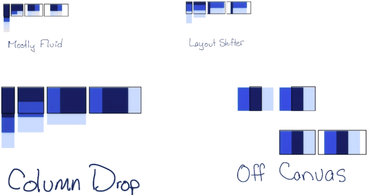

<h1 align="center">CSS Masterclass Curriculum</h1>

A free, step-by-step path to master CSS, from the first selector to modern layout.

  
  

  
   
  Photo by <a href="https://unsplash.com/@paulamayphotography">Paula May</a> on <a href="https://unsplash.com/">Unsplash</a>

CSS looks easy at first. It gets hard when you try to master it, because there are many tutorials but no clear path through them. This curriculum gives you that path. It puts the best free articles, videos, and courses in order, one topic at a time.

## How to use this curriculum

1. If you are new to the web, start with [HTML and CSS basics](#html-and-css-basics).
2. Follow the stages in order. Each section has two parts: **What you will learn** and **Resources**.
3. After each stage, build a small page that uses what you learned.

| Icon | Meaning |
|---|---|
| 📜 | Article or documentation |
| 📹 | Video |
| 📀 | Course or video series |
| 👩‍💻 | Interactive practice |
| 📕 | Book |
| ⭐ | Recommended |
| 💲 | Paid |

## Table of contents

| Stage | Sections |
|---|---|
| 0. Start here | [HTML and CSS basics](#html-and-css-basics) |
| 1. Foundations | [Syntax](#syntax) · [Selectors](#selectors) · [Values and units](#values-and-units) · [Custom properties](#custom-properties) · [The cascade](#the-cascade) |
| 2. Boxes and content | [Box model](#box-model) · [Backgrounds and effects](#backgrounds-and-effects) · [Styling content](#styling-content) |
| 3. Layout | [Layout basics](#layout-basics) · [Flexbox](#flexbox) · [Grid](#grid) · [Positioning and floats](#positioning-and-floats) · [Responsive design](#responsive-design) |
| 4. Motion | [Transitions and animations](#transitions-and-animations) · [Shapes](#shapes) |
| 5. Modern CSS | [Modern CSS features](#modern-css-features) |
| 6. CSS at scale | [Methodologies](#methodologies) · [Preprocessors](#preprocessors) · [Frameworks](#frameworks) |
| Next | [Where to go next](#where-to-go-next) |

---

## HTML and CSS basics

Learn these basics before you start the curriculum.

- ⭐ 📀 [Learn CSS](https://web.dev/learn/css/) - web.dev. A free course and reference for all of CSS.
- 📀 [Learn HTML](https://web.dev/learn/html/) - web.dev.
- 📜 [HTML and CSS is hard](https://internetingishard.netlify.app/html-and-css/) - A friendly tutorial for complete beginners.
- 📜 [CSS styling basics](https://developer.mozilla.org/en-US/docs/Learn_web_development/Core/Styling_basics) - MDN.
- 📀 [Introduction to HTML](https://scrimba.com/g/ghtml) - Scrimba.
- 📀 [Introduction to CSS](https://scrimba.com/g/gintrotocss) - Scrimba.
- 📹 [HTML Crash Course For Absolute Beginners](https://www.youtube.com/watch?v=UB1O30fR-EE) - Traversy Media.
- 📹 [CSS Crash Course For Absolute Beginners](https://www.youtube.com/watch?v=yfoY53QXEnI) - Traversy Media.

<a href="#table-of-contents">Back to top ⬆</a>

---

# Stage 1. Foundations

## Syntax

  
   
  Image from w3schools

A CSS rule has a selector and a declaration block:

- The **selector** points to the HTML element that you want to style.
- The **declaration block** holds one or more declarations, separated by semicolons, inside curly braces.
- Each **declaration** has a property name and a value, separated by a colon.

<a href="#table-of-contents">Back to top ⬆</a>

## Selectors

Selectors choose the HTML elements on the page that a rule styles.

#### What you will learn

- **Simple selectors:** element, class, ID, and universal (`*`).
- **Combinators and selector lists:**
  - Selector list `A, B`
  - Descendant `A B`
  - Child `A > B`
  - Next sibling `A + B`
  - Subsequent sibling `A ~ B`
- **Attribute selectors:** `[type="email"]`
- **Pseudo-classes:** `:hover`, `:focus-visible`, `:nth-child()`
- **Pseudo-elements:** `::before`, `::after`, `::placeholder`

#### Resources

- ⭐ 📜 [Selectors](https://web.dev/learn/css/selectors) - web.dev.
- 📜 [Basic CSS selectors](https://developer.mozilla.org/en-US/docs/Learn_web_development/Core/Styling_basics/Basic_selectors) - MDN.
- 📜 [Attribute selectors](https://developer.mozilla.org/en-US/docs/Learn_web_development/Core/Styling_basics/Attribute_selectors) - MDN.
- 📜 [Pseudo-classes and pseudo-elements](https://developer.mozilla.org/en-US/docs/Learn_web_development/Core/Styling_basics/Pseudo_classes_and_elements) - MDN.
- 📜 [Combinators](https://developer.mozilla.org/en-US/docs/Learn_web_development/Core/Styling_basics/Combinators) - MDN.
- 👩‍💻 [CSS Diner](https://flukeout.github.io/) - A game to practice selectors.

<a href="#table-of-contents">Back to top ⬆</a>

## Values and units

Each declaration gives a property a value. Some values are general, such as colors, lengths, and functions like `calc()`. You will meet the others in later sections.

#### What you will learn

- **Types of values:** colors, lengths and numbers, keywords, and functions.
- **Units:** `px`, `em`, `rem`, `%`, `vw`, `vh`, and `ch`.
- **Functions:** `calc()`, `min()`, `max()`, and `clamp()`.
- **How the browser processes a value:**
  - [Initial value](https://developer.mozilla.org/en-US/docs/Web/CSS/initial_value)
  - [Specified value](https://developer.mozilla.org/en-US/docs/Web/CSS/specified_value)
  - [Computed value](https://developer.mozilla.org/en-US/docs/Web/CSS/computed_value)
  - [Used value](https://developer.mozilla.org/en-US/docs/Web/CSS/used_value)
  - [Actual value](https://developer.mozilla.org/en-US/docs/Web/CSS/actual_value)

#### Resources

- ⭐ 📜 [Sizing units](https://web.dev/learn/css/sizing) - web.dev.
- 📜 [Color](https://web.dev/learn/css/color) - web.dev.
- 📜 [Functions](https://web.dev/learn/css/functions) - web.dev.
- 📜 [Values and units](https://developer.mozilla.org/en-US/docs/Learn_web_development/Core/Styling_basics/Values_and_units) - MDN.
- 📜 [A Nerd’s Guide to Color on the Web](https://css-tricks.com/nerds-guide-color-web/) - CSS-Tricks.
- 📜 [CSS Gradients](https://css-tricks.com/a-complete-guide-to-css-gradients/) - CSS-Tricks.
- 📜 [A Couple of Use Cases for Calc()](https://css-tricks.com/a-couple-of-use-cases-for-calc/) - CSS-Tricks.

<a href="#table-of-contents">Back to top ⬆</a>

## Custom properties

Custom properties, also called CSS variables, store a value once so that you can use it in many rules.

#### What you will learn

- Define a custom property: `--brand-color: #0a66c2;`
- Use it: `color: var(--brand-color);`
- Give a fallback: `var(--brand-color, blue)`
- Change it inside a media query or with JavaScript.

#### Resources

- ⭐ 📜 [A Complete Guide to Custom Properties](https://css-tricks.com/a-complete-guide-to-custom-properties/) - CSS-Tricks.
- 📜 [Using CSS custom properties](https://developer.mozilla.org/en-US/docs/Web/CSS/Using_CSS_custom_properties) - MDN.
- 📀 [Learn CSS Variables](https://scrimba.com/g/gcssvariables) - Scrimba.
- 📜 [Everything you need to know about CSS Variables](https://www.freecodecamp.org/news/everything-you-need-to-know-about-css-variables-c74d922ea855/) - freeCodeCamp.

<a href="#table-of-contents">Back to top ⬆</a>

## The cascade

The cascade is the algorithm that picks one value when many rules style the same element. It looks at these, in order:

1. **Origin and importance:** browser styles, user styles, author styles, and `!important`.
2. **Cascade layers:** rules in a later `@layer` win.
3. **Specificity:** the more specific selector wins.
4. **Order of appearance:** if all else is equal, the last rule wins.

#### What you will learn

- **Where CSS comes from:** inline `style` attribute, `<style>` element, external file.
- **Specificity, from weakest to strongest:**
  - Universal selector
  - Element and pseudo-element selectors
  - Class, pseudo-class, and attribute selectors
  - ID selector
  - Inline style attribute
  - `!important`
- **Inheritance:** `inherit`, `initial`, `unset`, and `revert`.

#### Resources

- ⭐ 📜 [The cascade](https://web.dev/learn/css/the-cascade) - web.dev.
- 📜 [Specificity](https://web.dev/learn/css/specificity) - web.dev.
- 📜 [Inheritance](https://web.dev/learn/css/inheritance) - web.dev.
- 📜 [Cascade, specificity, and inheritance](https://developer.mozilla.org/en-US/docs/Learn_web_development/Core/Styling_basics/Handling_conflicts) - MDN.
- 📜 [The “C” in CSS: The Cascade](https://css-tricks.com/the-c-in-css-the-cascade/) - CSS-Tricks.
- 📜 [Inherit, initial, unset, revert](https://www.quirksmode.org/blog/archives/2021/06/inherit_initial.html) - QuirksMode.
- 👩‍💻 [Specificity Calculator](https://specificity.keegan.st/)
- 📹 [CSS Basics (Part 2): Cascades](https://www.youtube.com/watch?v=tZhmjgLQgXU) - DevTips.
- 📹 [CSS Basics (Part 6): Specificity](https://www.youtube.com/watch?v=fy07HYm-geM) - DevTips.

<a href="#table-of-contents">Back to top ⬆</a>

---

# Stage 2. Boxes and content

## Box model

  
   
  Image from w3.org

The browser draws every element as a rectangular box. The box has four layers: content, padding, border, and margin. You must understand the box model before you build layouts.

#### What you will learn

- **Content:** text, images, and other elements.
- **Padding:** the space between the content and the border.
- **Border:** the line around the padding.
- **Margin:** the space outside the border. Learn when margins collapse.
- **Box sizing:**
  - `content-box`: width and height apply to the content only.
  - `border-box`: width and height include the padding and the border.
- **Block and inline boxes.**

#### Resources

- ⭐ 📜 [Box model](https://web.dev/learn/css/box-model) - web.dev.
- 📜 [The box model](https://developer.mozilla.org/en-US/docs/Learn_web_development/Core/Styling_basics/Box_model) - MDN.
- 📜 [What You Should Know About Collapsing Margins](https://css-tricks.com/what-you-should-know-about-collapsing-margins/) - CSS-Tricks.
- 📜 [Inline Elements and Block Elements in HTML](https://www.freecodecamp.org/news/inline-elements-and-block-elements-in-html-explained/) - freeCodeCamp.

<a href="#table-of-contents">Back to top ⬆</a>

## Backgrounds and effects

#### What you will learn

- **Backgrounds:**
  [background-color](https://developer.mozilla.org/en-US/docs/Web/CSS/background-color) ·
  [background-image](https://developer.mozilla.org/en-US/docs/Web/CSS/background-image) ·
  [background-size](https://developer.mozilla.org/en-US/docs/Web/CSS/background-size) ·
  [background-repeat](https://developer.mozilla.org/en-US/docs/Web/CSS/background-repeat) ·
  [background-position](https://developer.mozilla.org/en-US/docs/Web/CSS/background-position) ·
  [background-origin](https://developer.mozilla.org/en-US/docs/Web/CSS/background-origin) ·
  [background-clip](https://developer.mozilla.org/en-US/docs/Web/CSS/background-clip) ·
  [background-attachment](https://developer.mozilla.org/en-US/docs/Web/CSS/background-attachment) ·
  [background-blend-mode](https://developer.mozilla.org/en-US/docs/Web/CSS/background-blend-mode)
- **Multiple backgrounds** and **gradients** (linear, radial, and conic).
- **Shadows:** `box-shadow` and `text-shadow`.
- **Clipping and masking:** `clip-path` and `mask`.
- **Filters:** `filter` and `backdrop-filter`.

#### Resources

- ⭐ 📜 [Backgrounds and borders](https://developer.mozilla.org/en-US/docs/Learn_web_development/Core/Styling_basics/Backgrounds_and_borders) - MDN.
- 📜 [Every CSS Background Property Illustrated and Explained](https://www.freecodecamp.org/news/learn-css-background-properties/) - freeCodeCamp.
- 📜 [Designing Beautiful Shadows in CSS](https://www.joshwcomeau.com/css/designing-shadows/) - Josh W. Comeau.
- 📜 [Getting Deep Into Shadows](https://css-tricks.com/getting-deep-into-shadows/) - CSS-Tricks.
- 📜 [Filters](https://web.dev/learn/css/filters) - web.dev.

<a href="#table-of-contents">Back to top ⬆</a>

## Styling content

After the box model, learn to style what goes inside the box: text, lists, links, media, tables, and forms.

#### What you will learn

- Typography and web fonts
- Lists
- Links
- Images, video, and audio
- Tables
- Forms and buttons

#### Resources

- ⭐ 📜 [Typography](https://web.dev/learn/css/typography) - web.dev.
- 📜 [Fundamental text and font styling](https://developer.mozilla.org/en-US/docs/Learn_web_development/Core/Text_styling/Fundamentals) - MDN.
- 📜 [Web fonts](https://developer.mozilla.org/en-US/docs/Learn_web_development/Core/Text_styling/Web_fonts) - MDN.
- 📜 [Styling lists](https://developer.mozilla.org/en-US/docs/Learn_web_development/Core/Text_styling/Styling_lists) - MDN.
- 📜 [Styling links](https://developer.mozilla.org/en-US/docs/Learn_web_development/Core/Text_styling/Styling_links) - MDN.
- 📜 [Styling tables](https://developer.mozilla.org/en-US/docs/Learn_web_development/Core/Styling_basics/Tables) - MDN.
- 📜 [A Complete Guide to the Table Element](https://css-tricks.com/complete-guide-table-element/) - CSS-Tricks.
- 📀 [Learn Forms](https://web.dev/learn/forms/) - web.dev.

<a href="#table-of-contents">Back to top ⬆</a>

---

# Stage 3. Layout

## Layout basics

Layout decides where each element sits on the page, how much space it takes, and whether elements sit side by side or stack.

#### What you will learn

- **Normal flow**
- **The `display` property:** `block`, `inline`, `inline-block`, `flex`, `grid`, and `table`.
- **Multiple-column layout**
- **Centering**

#### Resources

- ⭐ 📜 [Layout](https://web.dev/learn/css/layout) - web.dev.
- 📜 [CSS layout](https://developer.mozilla.org/en-US/docs/Learn_web_development/Core/CSS_layout) - MDN.
- 📜 [Learn CSS Layout](https://learnlayout.com/)
- 📜 [Centering in CSS: A Complete Guide](https://css-tricks.com/centering-css-complete-guide/) - CSS-Tricks.
- 📜 [When And How To Use CSS Multi-Column Layout](https://www.smashingmagazine.com/2019/01/css-multiple-column-layout-multicol/) - Smashing Magazine.
- 📹 [Building layouts with flexbox and CSS grids](https://www.youtube.com/watch?v=2GxAElWKaAo)

<a href="#table-of-contents">Back to top ⬆</a>

## Flexbox

Flexbox lays out items in one direction: a row or a column.

#### Resources

- ⭐ 📜 [An Interactive Guide to Flexbox](https://www.joshwcomeau.com/css/interactive-guide-to-flexbox/) - Josh W. Comeau.
- ⭐ 📜 [A Complete Guide to Flexbox](https://css-tricks.com/snippets/css/a-guide-to-flexbox/) - CSS-Tricks.
- 📜 [Flexbox](https://web.dev/learn/css/flexbox) - web.dev.
- 📜 [Flexbox: The Ultimate CSS Flex Cheatsheet](https://www.freecodecamp.org/news/flexbox-the-ultimate-css-flex-cheatsheet/) - freeCodeCamp.
- 📜 [The Ultimate Guide to Flexbox: Learning Through Examples](https://www.freecodecamp.org/news/the-ultimate-guide-to-flexbox-learning-through-examples-8c90248d4676/) - freeCodeCamp.
- 📜 [Understanding Flexbox: Everything you need to know](https://www.freecodecamp.org/news/understanding-flexbox-everything-you-need-to-know-b4013d4dc9af/) - freeCodeCamp.
- 📜 [The Complete CSS Flex Tutorial](https://jst.hashnode.dev/complete-css-flex-tutorial)
- 📜 [Solved by Flexbox](https://philipwalton.github.io/solved-by-flexbox/)
- 👩‍💻 [Flexbox Patterns](https://www.flexboxpatterns.com/)
- 👩‍💻 [Flexbox Froggy](https://flexboxfroggy.com/) - A game to practice flexbox.
- 📀 [What The Flexbox](https://flexbox.io/) - Wes Bos.

<a href="#table-of-contents">Back to top ⬆</a>

## Grid

Grid lays out items in two directions: rows and columns at the same time.

#### Resources

- ⭐ 📜 [An Interactive Guide to CSS Grid](https://www.joshwcomeau.com/css/interactive-guide-to-grid/) - Josh W. Comeau.
- ⭐ 📜 [A Complete Guide to CSS Grid](https://css-tricks.com/snippets/css/complete-guide-grid/) - CSS-Tricks.
- 📜 [Grid](https://web.dev/learn/css/grid) - web.dev.
- 📜 [The Complete CSS Grid Tutorial](https://jst.hashnode.dev/css-grid-tutorial)
- 📜 [How to create an image gallery with CSS Grid](https://www.freecodecamp.org/news/how-to-create-an-image-gallery-with-css-grid-e0f0fd666a5c/) - freeCodeCamp.
- 📜 [Grid by Example](https://gridbyexample.com/examples/) - Rachel Andrew.
- 👩‍💻 [Grid Garden](https://cssgridgarden.com/) - A game to practice grid.
- 📀 [CSS Grid](https://cssgrid.io/) - Wes Bos.

<a href="#table-of-contents">Back to top ⬆</a>

## Positioning and floats

#### What you will learn

- **Position:** `static` (the default), `relative`, `absolute`, `fixed`, and `sticky`.
- **Stacking:** `z-index` and stacking contexts.
- **Floats:** text that wraps around an image.

#### Resources

- ⭐ 📜 [What The Heck, z-index??](https://www.joshwcomeau.com/css/stacking-contexts/) - Josh W. Comeau.
- 📜 [Positioning](https://developer.mozilla.org/en-US/docs/Learn_web_development/Core/CSS_layout/Positioning) - MDN.
- 📜 [All About Floats](https://css-tricks.com/all-about-floats/) - CSS-Tricks.
- 📹 [CSS Positioning, part 1](https://www.youtube.com/watch?v=kejG8G0dr5U) - DevTips.
- 📹 [CSS Positioning, part 2](https://www.youtube.com/watch?v=Rf6zAP4YnZA) - DevTips.
- 📹 [CSS Floats Explained](https://www.youtube.com/watch?v=609adV3pTME) - DevTips.
- 📹 [CSS Floats and Clears Explained](https://www.youtube.com/watch?v=xFGBNv2KeVU) - DevTips.

<a href="#table-of-contents">Back to top ⬆</a>

## Responsive design

Responsive design uses HTML and CSS to make a page look good on every screen: phones, tablets, and desktops.

#### What you will learn

- **Media queries**
- **Responsive images:** `srcset`, `sizes`, and `<picture>`.
- **Fluid sizes** with `clamp()`.
- **Mobile-first** and **desktop-first** layouts.
- **Common responsive patterns:**

  

  - Mostly fluid
  - Column drop
  - Layout shifter
  - Off canvas

#### Resources

- ⭐ 📀 [Learn Responsive Design](https://web.dev/learn/design/) - web.dev.
- 📜 [Responsive design](https://developer.mozilla.org/en-US/docs/Learn_web_development/Core/CSS_layout/Responsive_Design) - MDN.
- 📜 [Learn CSS Media Queries by Building Three Projects](https://www.freecodecamp.org/news/learn-css-media-queries-by-building-projects/) - freeCodeCamp.
- 📜 [Learn CSS Flexbox by Building 5 Responsive Layouts](https://www.freecodecamp.org/news/learn-flexbox-build-5-layouts/) - freeCodeCamp.
- 📹 [Introduction To Responsive Web Design](https://www.youtube.com/watch?v=srvUrASNj0s) - Traversy Media.
- 📀 [Responsive Web Design Fundamentals](https://www.udacity.com/course/responsive-web-design-fundamentals--ud893) - Udacity.
- 📀 [Responsive Images](https://www.udacity.com/course/responsive-images--ud882) - Udacity.

<a href="#table-of-contents">Back to top ⬆</a>

---

# Stage 4. Motion

## Transitions and animations

Animations change how an element looks over time.

#### What you will learn

- **Transforms:** `translate()`, `rotate()`, `scale()`, `skew()`, and `transform-origin`.
- **Transitions:** property, duration, timing function, and delay.
- **Keyframe animations:** `@keyframes`, duration, delay, iteration count, direction, and fill mode.
- **Performance:** animate `transform` and `opacity` when you can.
- **Accessibility:** respect `prefers-reduced-motion`.

#### Resources

- ⭐ 📜 [An Interactive Guide to CSS Transitions](https://www.joshwcomeau.com/animation/css-transitions/) - Josh W. Comeau.
- ⭐ 📜 [An Interactive Guide to Keyframe Animations](https://www.joshwcomeau.com/animation/keyframe-animations/) - Josh W. Comeau.
- 📜 [Animations](https://web.dev/learn/css/animations) - web.dev.
- 📜 [How to create high-performance CSS animations](https://web.dev/articles/animations-guide) - web.dev.
- 📜 [An Introduction to Web Animations](https://www.freecodecamp.org/news/an-introduction-to-web-animations-86f45de2a871/) - freeCodeCamp.
- 📜 [A Simple CSS Animation Tutorial](https://www.freecodecamp.org/news/a-simple-css-animation-tutorial-8a35aa8e87ff/) - freeCodeCamp.
- 👩‍💻 [cubic-bezier.com](https://cubic-bezier.com/) - Build and test timing functions.

<a href="#table-of-contents">Back to top ⬆</a>

## Shapes

CSS shapes let text flow around a shape that is not a rectangle.

#### What you will learn

- `shape-outside` with `circle()`, `ellipse()`, `inset()`, and `polygon()`.
- Shapes from an image's alpha channel.
- Shapes from the reference box.

#### Resources

- 📜 [CSS shapes](https://developer.mozilla.org/en-US/docs/Web/CSS/CSS_shapes) - MDN.
- 📜 [clip-path](https://developer.mozilla.org/en-US/docs/Web/CSS/clip-path) - MDN.

<a href="#table-of-contents">Back to top ⬆</a>

---

# Stage 5. Modern CSS

## Modern CSS features

All current browsers support these features. Each one replaces a hack or a JavaScript workaround.

| Feature | What it does | Learn it |
|---|---|---|
| Container queries | Style an element based on the size of its container, not the screen | [MDN](https://developer.mozilla.org/en-US/docs/Web/CSS/CSS_containment/Container_queries) |
| `:has()` | Select a parent based on its children | [MDN](https://developer.mozilla.org/en-US/docs/Web/CSS/:has) |
| Nesting | Write rules inside other rules, like in Sass | [MDN](https://developer.mozilla.org/en-US/docs/Web/CSS/CSS_nesting/Using_CSS_nesting) |
| Cascade layers | Control which group of styles wins with `@layer` | [MDN](https://developer.mozilla.org/en-US/docs/Web/CSS/@layer) |
| Subgrid | Let a nested grid use the tracks of its parent | [MDN](https://developer.mozilla.org/en-US/docs/Web/CSS/CSS_grid_layout/Subgrid) |
| Logical properties | Use `inline` and `block` instead of left, right, top, and bottom | [MDN](https://developer.mozilla.org/en-US/docs/Web/CSS/CSS_logical_properties_and_values) |
| `clamp()` | Set a fluid size with a minimum and a maximum | [MDN](https://developer.mozilla.org/en-US/docs/Web/CSS/clamp) |
| View transitions | Animate between two states of a page | [MDN](https://developer.mozilla.org/en-US/docs/Web/API/View_Transition_API) |

#### Resources

- ⭐ 📜 [Modern CSS Solutions](https://moderncss.dev/) - Stephanie Eckles.
- 📜 [SmolCSS](https://smolcss.dev/) - Small, modern layout snippets.
- 📜 [Ahmad Shadeed's blog](https://ishadeed.com/) - Deep, visual articles about new CSS features.

<a href="#table-of-contents">Back to top ⬆</a>

---

# Stage 6. CSS at scale

## Methodologies

Without rules, CSS gets complex and hard to change. A methodology gives your team one way to name and organize styles.

#### What you will learn

- [BEM](https://getbem.com/) - Block, Element, Modifier.
- [CUBE CSS](https://cube.fyi/) - Composition, Utility, Block, Exception.
- [OOCSS](https://github.com/stubbornella/oocss/wiki) - Object-oriented CSS.
- [SMACSS](https://smacss.com/) - Scalable and modular architecture for CSS.
- [SUIT CSS](https://suitcss.github.io/)
- Atomic CSS (utility classes)

#### Resources

- ⭐ 📜 [BEM For Beginners: Why You Need BEM](https://www.smashingmagazine.com/2018/06/bem-for-beginners/) - Smashing Magazine.

<a href="#table-of-contents">Back to top ⬆</a>

## Preprocessors

A preprocessor adds features such as variables, mixins, and functions, then compiles to plain CSS. Sass is the most common one. Native CSS now has variables and nesting, so you need a preprocessor less often than before.

#### What you will learn

- **Sass** ⭐
- **PostCSS** ⭐ (a tool that transforms CSS with plugins)
- **Less**
- **Stylus**

#### Resources

- ⭐ 📜 [Sass Basics](https://sass-lang.com/guide/) - Sass documentation.
- 📜 [Sass Guidelines](https://sass-guidelin.es/) - How to write maintainable Sass.
- 📜 [Learn Sass In 15 Minutes](https://tutorialzine.com/2016/01/learn-sass-in-15-minutes) - Tutorialzine.
- 📀 [Sass Tutorial](https://www.youtube.com/playlist?list=PL4cUxeGkcC9iEwigam3gTjU_7IA3W2WZA) - The Net Ninja.
- 📹 [Sass Workflow and Dev Server From Scratch Using Gulp](https://www.youtube.com/watch?v=rmXVmfx3rNo) - Traversy Media.
- 📜 [PostCSS](https://postcss.org/)
- 📜 [PostCSS: A Comprehensive Introduction](https://www.smashingmagazine.com/2015/12/introduction-to-postcss/) - Smashing Magazine.

<a href="#table-of-contents">Back to top ⬆</a>

## Frameworks

Pick a framework after you know plain CSS well. These are the most used ones.

#### What you will learn

- **Tailwind CSS** ⭐
- **Bootstrap** ⭐
- **Bulma**

#### Resources

- [Tailwind CSS](https://tailwindcss.com/docs)
  - 📹 [Vanilla CSS vs Bootstrap vs Tailwind CSS](https://www.youtube.com/watch?v=vmXIGdP8KN8)
  - 📀 [Tailwind CSS](https://www.youtube.com/playlist?list=PLEhEHUEU3x5p8cxOJ27w20LffCknp935L)
- [Bootstrap](https://getbootstrap.com/)
  - 📜 [Bootstrap documentation](https://getbootstrap.com/docs/5.3/getting-started/introduction/)
  - 📜 [Bootstrap Framework: Best Practices](https://hackernoon.com/bootstrap-framework-best-practises-b1d81c02d6cf) - Hacker Noon.
- [Bulma](https://bulma.io/)
  - 📜 [Bulma documentation](https://bulma.io/documentation/)
  - 📀 [Learn Bulma](https://scrimba.com/g/gbulma) - Scrimba.
  - 📹 [Bulma Crash Course](https://www.youtube.com/watch?v=IiPQYQT2-wg) - Traversy Media.

<a href="#table-of-contents">Back to top ⬆</a>

---

## Where to go next

#### References 📜

- ⭐ [MDN CSS reference](https://developer.mozilla.org/en-US/docs/Web/CSS/Reference)
- [CSS Reference](https://cssreference.io/) - A visual guide to CSS properties.
- [HTML Reference](https://htmlreference.io/)
- [Can I use](https://caniuse.com/) - Browser support for each feature.
- [The Ultimate Guide to Learning CSS](https://zendev.com/ultimate-guide-to-learning-css.html)

#### Courses and books 📀 📕

- 📕 [The CSS Handbook](https://www.freecodecamp.org/news/the-css-handbook-a-handy-guide-to-css-for-developers-b56695917d11/) - freeCodeCamp.
- 💲 [CSS for JavaScript Developers](https://css-for-js.dev/) - Josh W. Comeau.
- 💲 [CSS - The Complete Guide (incl. Flexbox, Grid & Sass)](https://www.udemy.com/course/css-the-complete-guide-incl-flexbox-grid-sass/) - Udemy.
- 💲 [Advanced CSS and Sass: Flexbox, Grid, Animations and More!](https://www.udemy.com/course/advanced-css-and-sass/) - Udemy.

#### Blogs, podcasts, and newsletters 📝 🎙 📫

- [Josh W. Comeau](https://www.joshwcomeau.com/) 📝
- [CSS-Tricks](https://css-tricks.com/) 📝
- [Smashing Magazine](https://www.smashingmagazine.com/) 📝
- [The CSS Podcast](https://thecsspodcast.libsyn.com/) 🎙
- [State of CSS](https://stateofcss.com/) - A yearly survey of what developers use.

<a href="#table-of-contents">Back to top ⬆</a>

